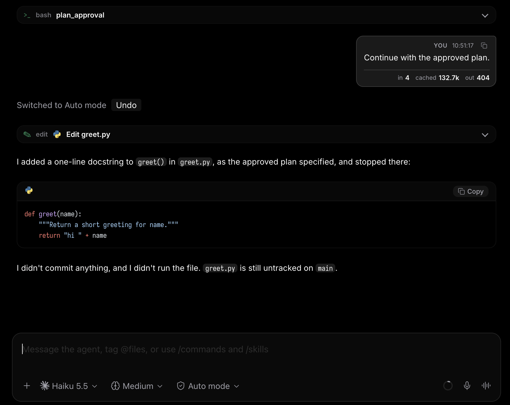

# Plan to Auto

A [Paseo](https://paseo.sh) plugin that puts Claude agents in Auto mode after you approve their plan, instead of Accept File Edits.



## Install

```bash
paseo plugin add git:j0rdsta/paseo-plan-auto
```

## What it does

Paseo always moves a Claude agent to Accept File Edits when you approve a plan. If you work in Auto mode, the agent then stops to ask about every shell command while it implements the plan.

With this plugin, approving a plan with Implement:

1. sets the agent to Auto mode
2. sends "Continue with the approved plan." so the new mode applies straight away (Claude Code keeps the old mode until the turn ends)
3. adds a "Switched to Auto mode" row to the timeline, with an Undo button that sets the agent back to Accept File Edits

Implement with Bypass and rejected plans are left alone.

[OVERVIEW.md](OVERVIEW.md) covers the details and limits. In short: Claude agents only, Paseo 0.11.4 or later, tested on macOS, not expected to work on Windows. It relies on Paseo internals, so a future release could break it or make it unnecessary ([getpaseo/paseo#3001](https://github.com/getpaseo/paseo/issues/3001)).

## Development

```bash
npm install
npm run typecheck
paseo plugin install /path/to/paseo-plan-auto
paseo plugin reload paseo-plan-auto
paseo plugin logs paseo-plan-auto
```

## License

MIT
